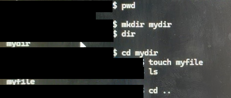
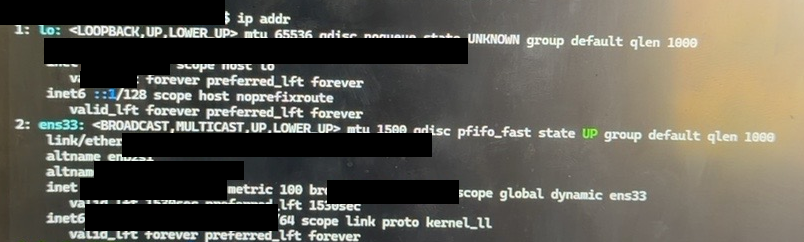
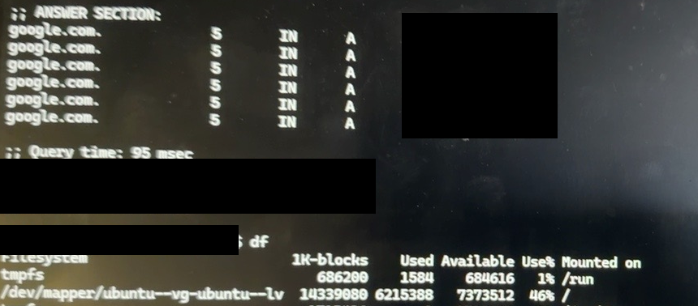
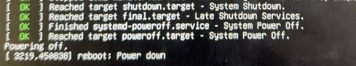

# Ubuntu Server Administration Lab

## Overview

NETI 104 coursework covering shell navigation, networking tools, filesystem usage, and guest shutdown.

## Objective

Practice day-to-day Ubuntu Server checks in a virtual machine.

## Environment / Tools

Ubuntu Server in VMware Workstation, the Linux shell, APT, net-tools, iproute2, and DNS utilities.

## Skills Demonstrated

Filesystem navigation, package management, interface inspection, DNS testing, checking filesystem usage, and shutting down a guest.

## What I Did

- Navigated and worked with directories and files using `pwd`, `mkdir`, `cd`, `dir`, `touch`, and `ls`, including `ls -l`. I worked with `/etc` and `/home`.
- Tested the loopback interface with ping, ran `sudo apt update`, installed the net-tools package, and inspected networking with `ifconfig`, `ip addr`, and `ip help`.
- Used `dig google.com` for a DNS lookup and `df` to inspect filesystem usage.
- Closed an SSH session with `exit`. The guest console later showed that Ubuntu had powered down.

## Validation / Results

I identified a private lab IPv4 address on `ens33`, queried DNS, and inspected filesystem usage. The screenshots show the SSH session closing and the guest reaching the power-off target. The command that initiated guest shutdown is outside the capture. SSH connection setup and authentication details remain undocumented.

## Troubleshooting / Lessons Learned

Loopback testing, interface inspection, and DNS lookup serve different purposes. The loopback check stays on the guest, interface output shows local addressing, and the DNS query checks name resolution.

## Evidence

The shell shows directory navigation, file creation with `touch`, and the resulting listing.

The `ip addr` output shows `ens33` up with a dynamic lab IPv4 assignment.

The terminal shows DNS A-record answers and `df` output for the root filesystem.

The terminal shows `exit`, logout, a closed connection, and the return to PowerShell.

The console shows the guest reaching the power-off target and reporting power down.

See the [evidence index](evidence/README.md).

## Evidence Privacy

The screenshots mask the private guest address and identifying prompts or paths. The SSH crop shows session closure, and the separate shutdown crop shows the guest console reaching power-off.
