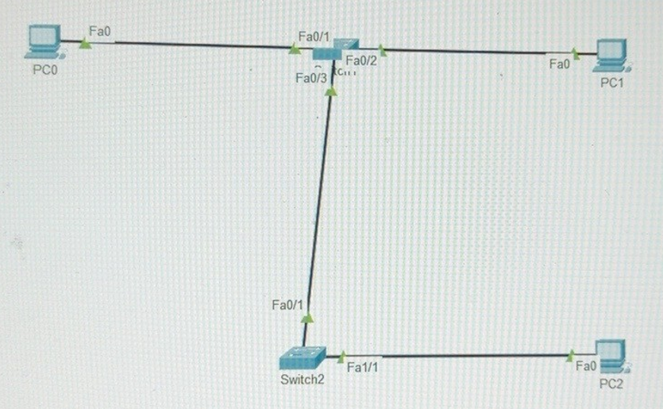
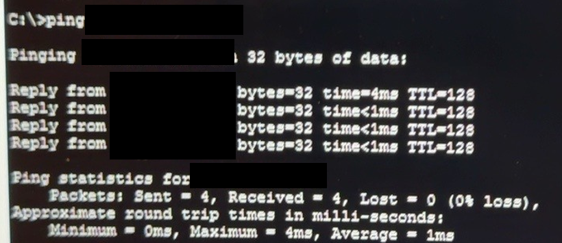
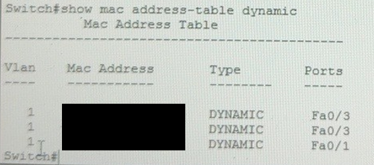

# Cisco Packet Tracer Networking Lab

## Overview

NETI 104 Introduction to Networking coursework covering connectivity and dynamic MAC learning in a simulated two-switch LAN.

## Objective

Validate IPv4 connectivity and explain how switches learn MAC addresses on local and inter-switch ports.

## Environment / Tools

Cisco Packet Tracer, three simulated PCs, two switches, ping, and Cisco switch CLI.

## Skills Demonstrated

Static IPv4 configuration, connectivity testing, Cisco switch CLI, and MAC table interpretation.

## What I Did

I built a LAN with three PCs and two interconnected switches, assigned static IPv4 addresses in one /24 subnet, and generated traffic with ping. I inspected the first switch with `show mac address-table dynamic`.

## Validation / Results

The PC2-to-PC0 ping sent four packets and received four replies with 0% loss. The final table showed three dynamic VLAN 1 entries. Two appeared on Fa0/3, the link to the second switch.

## Lessons Learned

A switch learns from source MAC addresses as frames arrive. The two entries on Fa0/3 show how several MAC addresses can be reachable through one inter-switch port.

## Evidence

Three PCs and two switches with active links. The inter-switch link uses Fa0/3 on the first switch.

The final PC2-to-PC0 test sent four packets and received four replies with 0% loss.

The final CLI output shows three dynamic VLAN 1 entries, including two learned on Fa0/3.

See the [evidence index](evidence/README.md).

## Evidence Privacy

The evidence retains device labels, ports, and packet totals. Simulated IP and MAC values are masked where visible.
